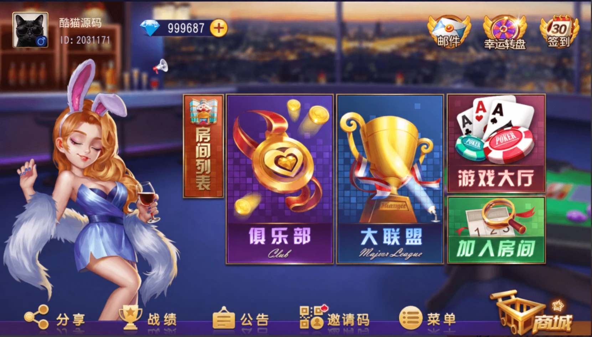
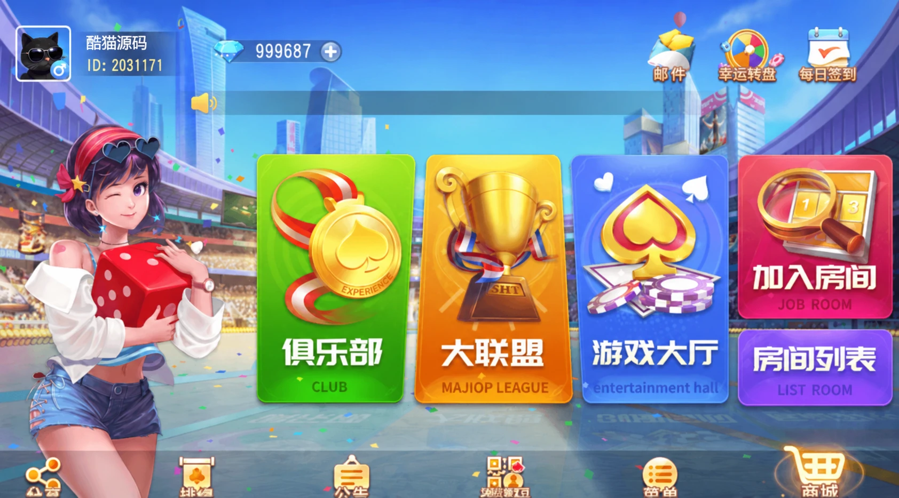
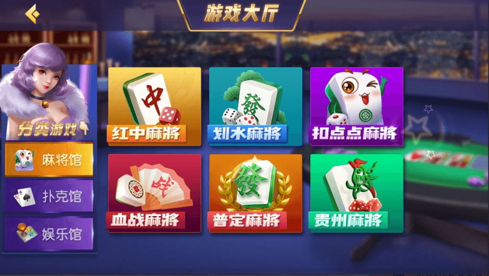

# 创胜新闲乐：16款玩法与双UI配置

创胜系列新闲乐提供16款玩法和两套UI版本客户端。两套大厅都包含俱乐部、大联盟、游戏大厅、加入房间与房间列表等入口，采用不同人物、背景与按钮排版。

## 两套大厅

深色大厅以紫蓝色为主，房间列表采用竖向入口；明亮大厅采用城市背景，把房间列表和加入房间放在右侧。





## 玩法分类

麻将包括红中麻将、划水麻将、扣点点麻将、血战麻将、普定麻将和贵州麻将；其他玩法包括牛牛、斗地主、三公、金花、跑得快、斗红牛、五十K、填大坑、牌九和跑胡子。大厅用分类入口组织玩法列表。



大厅账号及模拟器边框经AI整理，配图不代表软件功能变更。

## 主题与玩法分离

双UI项目可以把玩法标识、名称与规则配置放在共用数据层，把背景、按钮颜色与图标映射放在主题层。切换主题只改变表现，点击同一个玩法仍传递同一个标识，避免把按钮排列顺序当作玩法编号。

以下是独立JavaScript示例，不是原项目实现。示例为同一玩法列表生成两种主题视图，并检查重复标识。

```js
// 独立示例，主题只影响显示信息。
const themes = new Map([
  ['night', {background: '#241f42', accent: '#e6bd64'}],
  ['city', {background: '#277ac4', accent: '#ffe276'}]
]);
export function makeView(games, themeId) {
  const theme = themes.get(themeId) ?? themes.get('night');
  const ids = new Set();
  const items = games.map(game => {
    if (!game || typeof game.id !== 'string' || !game.id ||
        typeof game.name !== 'string' || !game.name)
      throw new TypeError('玩法信息不完整');
    if (ids.has(game.id)) throw new Error('玩法标识重复');
    ids.add(game.id);
    return {id: game.id, name: game.name};
  });
  return {theme: {...theme}, items};
}
```

返回的主题对象和列表条目都重新构造，界面修改不会覆盖输入数据或共用主题。示例仅复制标识与名称，其他业务字段应在数据层显式定义，不能随主题配置一起覆盖。

图片资源也可以按主题建立映射，但规则参数、房间状态与请求权限不应放进美术配置中。若新主题缺少某张图标，可以回退到默认图标，同时保留原玩法标识。

## 示例验证

[example.mjs](example.mjs)与[test.mjs](test.mjs)验证主题切换、未知主题回退、对象隔离、重复标识和无效记录。运行`node test.mjs`，7项断言通过。示例不连接游戏服务器。

## 技术交流

[Telegram @root4433](https://t.me/root4433)
